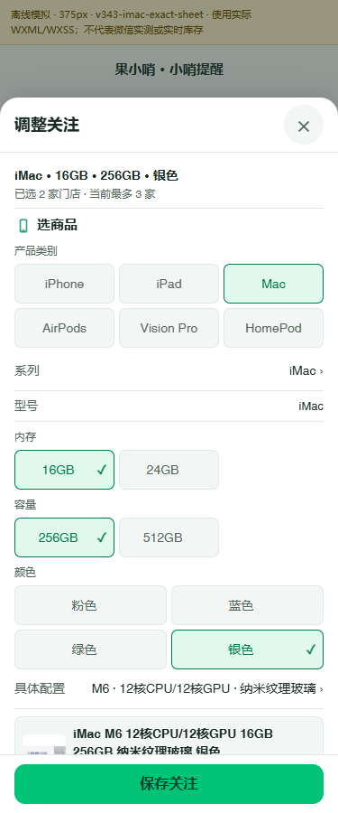
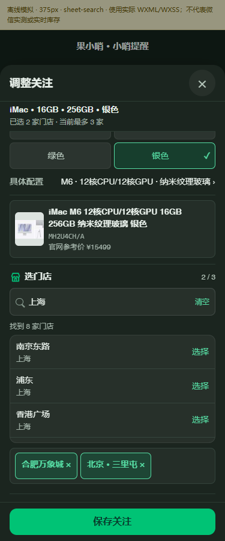
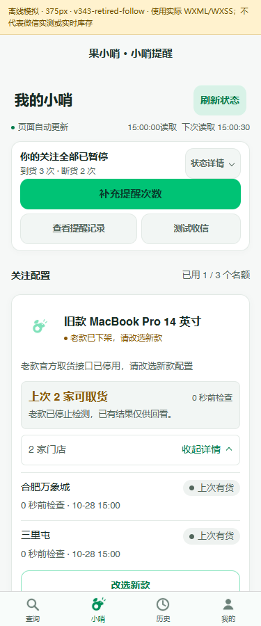

# 3.4.3 设计参照与实际使用证据

本目录供后续设计工作复用。2026-10-28 发布收尾将以下少量截图和源码包明确纳入 Git，补齐此前只在本地保存的附件；不包含 node_modules、引擎二进制或全部预览输出。

## shadcn/create

- [最终可视化 preset b2BnwlLhw](https://ui.shadcn.com/create?preset=b2BnwlLhw&template=vite)
- [导出配置](shadcn-preset.json)、[导出主题](shadcn-preset.css)
- [实际 CLI 与构建记录](shadcn-cli-verification.json)、[浏览器交互记录](shadcn-browser-verification.json)
- [可复现的 Web 参照源码 ZIP](shadcn-reference-source.zip)：64,728 B；固定依赖和复现命令见 CLI 记录。使用独立目录解压；它是 Web 参照，不是小程序初始化包。
- [官方浅色配置](shadcn-create-light.jpg)、[官方深色配置](shadcn-create-dark.jpg)、[生成命令](shadcn-create-command.jpg)
- [参照页浅色](shadcn-reference-light.jpg)、[参照页深色](shadcn-reference-dark.jpg)

## 果小哨界面

以下来自正式版定稿源码的 WXML/WXSS 离线渲染，数据为模拟值，保留顶部离线标识。它们不代表微信真机、当前库存或云端状态。

## 审查与规范

- [Impeccable 实际使用记录](impeccable-actual-use.json)：固定官方 skill 与 engine，含原生审查、HTML 检测、原始告警和修复闭环。WXML 不受 engine 自动源码扫描支持。
- [长期设计规范](../../../DESIGN.md)
- [完整设计审查](../../../docs/DESIGN_REVIEW_3.4.3_20261028.md)
- [正式发布交接](../../../docs/RELEASE_3.4.3_HANDOFF.md)

`artifact-manifest.json` 和两个设计验证 JSON 保留上一轮当地执行时的路径与哈希，是历史证据。发布收尾新增的 GitHub 附件、当前源码指纹和验证数据见本轮发布交接，不将旧前端指纹用于关闭当前微信 finding。
